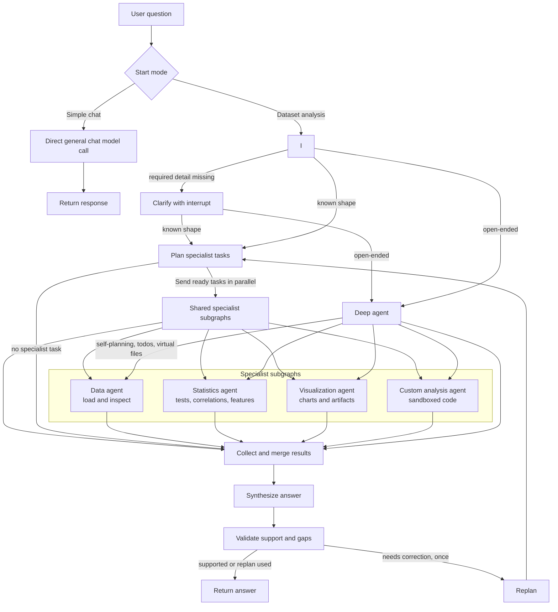

# 📊 Winnow

A **LangGraph data analyst** with a dependency-aware workflow and an open-ended Deep Agent path, powered by specialized agents and an OpenAI-compatible model.

> Ask Winnow a question in simple chat, or upload a CSV/Excel file and ask a focused question about your data.

## Architecture



The web app offers two start modes. **Simple chat** starts a conversation with
or without a dataset. Users can select an already uploaded dataset or upload a
new one; Winnow passes its schema, summary statistics, and a small row sample
to the chat model. Chat turns go directly to the model and bypass the data
analysis workflow. For exact calculations across all rows, use **Dataset
analysis**, which lets users select an existing dataset or upload a CSV/XLSX
file before starting the workflow with their question. The outer `StateGraph`
classifies dataset requests after understanding them. Focused,
well-shaped work uses the DAG planner, which sends ready tasks to shared data,
statistics, visualization, and sandboxed analysis subgraphs; dependency steps
run in later batches. Open-ended exploratory requests use a Deep Agent with its
own self-planning loop, todo list, and virtual files. It delegates to those same
compiled specialist workers, then joins the shared synthesis and validation
path. If validation finds a concrete gap, the DAG workflow can replan once. The
clarification node uses LangGraph `interrupt()`; the API and UI resume the same
thread after the user answers. The graph currently uses `MemorySaver`, so thread
checkpoints last only for the lifetime of the API process.

## Quick Start

### 1. Install with `uv` (Recommended — 10-100x faster)

```bash
cd winnow

# Create virtual environment and install all dependencies
uv venv
source .venv/bin/activate
uv pip install -e .
```

*(Alternatively with standard pip: `python3 -m venv .venv && source .venv/bin/activate && pip install -e .`)*

### 2. Configure

```bash
cp .env.example .env
# Edit .env and add your GROQ_API_KEY, NVIDIA_API_KEY, or OPENAI_API_KEY
```

Install the tracing dependencies with the rest of the project using `uv sync`
(or `pip install -e .`). To send traces to Phoenix, set
`WINNOW_PHOENIX_ENABLED=true` in `.env`. The default collector endpoint is
local Phoenix at `http://localhost:6006/v1/traces`. For Phoenix Cloud or a
self-hosted server, set `PHOENIX_COLLECTOR_ENDPOINT` to its OTLP trace endpoint
and set `PHOENIX_API_KEY` if authentication is enabled. `PHOENIX_PROJECT_NAME`
defaults to `winnow`. Tracing stays disabled by default.

To run the Phoenix UI locally, install its server package and start it from the
project root:

```bash
uv pip install arize-phoenix
PHOENIX_WORKING_DIR=.phoenix-data .venv/bin/phoenix serve
```

Open `http://localhost:6006`. Phoenix keeps its SQLite database under
`.phoenix-data/`, which is ignored by Git.

When enabled, each API or CLI workflow is captured through Phoenix's
OpenInference LangChain instrumentation and grouped by conversation thread.
Traces include model and tool runs, timings, inputs, outputs, and errors.
Prompts and tool data may contain dataset content, so enable tracing only when
you want that information sent to your Phoenix instance. See the [Phoenix
LangChain tracing guide](https://arize.com/docs/phoenix/integrations/python/langchain/langchain-tracing).

### 3. Run

```bash
uv run python src/main.py
# or: python src/main.py
```

### 4. Run the React web app

Start the API from the project root in one terminal:

```bash
python -m uvicorn src.api:app --reload
```

Then start the React development server in another terminal:

```bash
cd frontend
npm install
npm run dev
```

Open the local URL printed by Vite. Choose **Analyze a dataset** to select a
dataset already in the workspace or upload a CSV/XLSX file, then enter the
question you want Winnow to investigate. Choose
**Simple chat** to start a conversation, optionally select an existing dataset
or upload one, then continue in the chat composer. For a single-server
deployment, build the UI with `npm run build`; FastAPI serves `frontend/dist`
when it exists.

### Workflow logs

API and CLI runs print workflow events to the terminal. Events include the
thread ID, selected route, ready DAG steps, specialist and tool start/completion,
durations, collection, synthesis, validation, and replanning. Upload restoration
and chat failures are logged too. Logs include task and result lengths rather
than prompt or dataset contents. Set `WINNOW_LOG_LEVEL=WARNING` to reduce
workflow detail; the default is `INFO`. Terminal output uses colored `*** STAGE ***`
markers when supported. Parallel tool calls include a short `call_id` so separate
calls to the same tool are easy to tell apart. Set `NO_COLOR=1` to disable colors.
Provider calls retry transient rate limits up to four times. If the provider
still returns HTTP 429, Winnow reports that the provider is busy and includes
the provider's `Retry-After` delay when available. Provider token-throughput
errors are reported separately with guidance to shorten the request or change
to a model with a higher input-token allowance.

## Usage Examples

### Web app

- **Analyze a dataset:** select an existing dataset or upload a CSV/XLSX file,
  then enter a question such as “Which factors are most associated with
  customer churn?” and start the analysis. Winnow inspects the relevant data and responds with
  findings and visualizations where useful.
- **Simple chat:** select **Simple chat**, optionally select a loaded dataset or
  upload a CSV/XLSX file, then ask a question and continue with follow-ups. No
  file is required for general conversation. Simple chat uses a compact dataset
  summary and sample; use dataset analysis for calculations across the full file.

### CLI

```
You: Load the file sample_data/iris.csv as "iris"
Winnow: ✅ Successfully loaded iris with shape (150, 5).

You: Show me the first few rows
Winnow: [displays formatted table]

You: What are the correlations between features?
Winnow: [computes correlation matrix, explains findings]

You: Create a scatter plot of sepal_length vs petal_length colored by species
Winnow: 📊 Plot saved to: outputs/scatter_abc123.png

You: Which features are most important for predicting species?
Winnow: [runs Random Forest, ranks features by importance]

You: Run a custom analysis: show the distribution of petal_width per species
Winnow: [executes Python code with pandas/seaborn]
```

### Chat Commands

| Command      | Description                    |
|-------------|--------------------------------|
| `/quit`     | Exit Winnow                    |
| `/clear`    | Clear conversation history     |
| `/datasets` | List all loaded datasets       |

## Available Tools

### Data Loading
| Tool | Description |
|------|-------------|
| `load_csv` | Load a CSV file into memory |
| `load_excel` | Load an Excel file (specify sheet) |
| `list_datasets` | List all loaded datasets |
| `preview_data` | Show first N rows of a dataset |
| `get_column_info` | Show dtypes, null counts, unique values |

### Statistical Analysis
| Tool | Description |
|------|-------------|
| `describe_data` | Full descriptive statistics |
| `correlation_matrix` | Correlation matrix (pearson/spearman/kendall) |
| `value_counts` | Value counts for a column |
| `group_statistics` | GroupBy analysis (mean, sum, count, etc.) |
| `statistical_test` | T-test, Pearson correlation |
| `detect_outliers` | Outlier detection via IQR |

### Visualization
| Tool | Description |
|------|-------------|
| `plot_histogram` | Histogram with configurable bins |
| `plot_scatter` | Scatter plot with optional hue |
| `plot_correlation_heatmap` | Annotated correlation heatmap |
| `plot_boxplot` | Box plot, optionally grouped |
| `plot_pairplot` | Pair plot for selected columns |
| `plot_distribution` | KDE + histogram overlay |

### Feature Analysis
| Tool | Description |
|------|-------------|
| `feature_importance` | Random Forest feature importance |
| `feature_correlation_with_target` | Correlations with a target variable |
| `suggest_features` | Recommend best features for modeling |

### Code Execution
| Tool | Description |
|------|-------------|
| `execute_python` | Run arbitrary Python in a sandboxed environment with pandas, numpy, seaborn, matplotlib, scipy, and sklearn pre-loaded |

## Project Structure

```
winnow/
├── pyproject.toml              # Dependencies & project config
├── .env.example                # API key template
├── .gitignore
├── README.md
├── frontend/                   # React + Vite web interface
├── src/
│   ├── main.py                 # Interactive chat loop (Rich UI)
│   ├── api.py                  # FastAPI upload and chat endpoints
│   ├── agent/
│   │   ├── graph.py            # LangGraph ReAct agent
│   │   ├── state.py            # Agent state definition
│   │   └── prompts.py          # System prompt
│   ├── tools/
│   │   ├── data_loader.py      # CSV/Excel loading tools
│   │   ├── analysis.py         # Statistical analysis tools
│   │   ├── visualization.py    # Seaborn/Matplotlib charts
│   │   ├── feature_analysis.py # Feature importance & selection
│   │   └── code_executor.py    # Sandboxed Python execution
│   └── utils/
│       └── sandbox.py          # Safe exec() environment
├── outputs/                    # Generated charts & reports
└── sample_data/                # Drop your datasets here
```

## Tech Stack

- **LangGraph** — ReAct agent orchestration with checkpointing
- **OpenAI GPT-4o** — LLM backbone
- **pandas** — Data manipulation
- **seaborn / matplotlib** — Visualization
- **scikit-learn** — Feature importance
- **scipy** — Statistical tests
- **Rich** — Terminal UI
- **React + Vite** — Browser interface for upload and analysis
- **FastAPI** — Upload and chat API

## License

MIT
