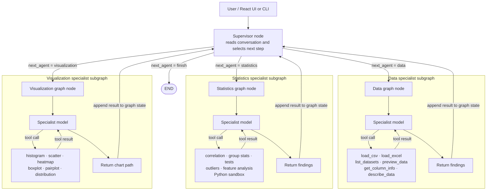

# 📊 Winnow

A **supervisor with specialist ReAct agents** for interactive data analysis, powered by **LangGraph** and an OpenAI-compatible model.

> Drop in any CSV/Excel file, and Winnow will analyze, visualize, and explain your data — all through natural language conversation.

## Architecture



The supervisor and specialist nodes form the outer `StateGraph`. Conditional
edges select one specialist or finish the turn. Each specialist node invokes
a focused agent subgraph, whose model can call only that specialist's tools.
Results return to the shared graph state for the supervisor to use in its next
decision. The outer graph uses `MemorySaver` to retain conversation state by
thread.

## Quick Start

### 1. Install with `uv` (Recommended — 10-100x faster)

```bash
cd winnow

# Create virtual environment and install all dependencies
uv venv
source .venv/bin/activate
uv pip install -e .
```

*(Alternatively with standard pip: `python3 -m venv .venv && source .venv/bin/activate && pip install -e .`)*

### 2. Configure

```bash
cp .env.example .env
# Edit .env and add your GROQ_API_KEY, NVIDIA_API_KEY, or OPENAI_API_KEY
```

### 3. Run

```bash
uv run python src/main.py
# or: python src/main.py
```

### 4. Run the React web app

Start the API from the project root in one terminal:

```bash
python -m uvicorn src.api:app --reload
```

Then start the React development server in another terminal:

```bash
cd frontend
npm install
npm run dev
```

Open the local URL printed by Vite. Upload a CSV or XLSX file to start the
initial analysis automatically. For a single-server deployment, build the UI
with `npm run build`; FastAPI serves `frontend/dist` when it exists.

## Usage Examples

```
You: Load the file sample_data/iris.csv as "iris"
Winnow: ✅ Successfully loaded iris with shape (150, 5).

You: Show me the first few rows
Winnow: [displays formatted table]

You: What are the correlations between features?
Winnow: [computes correlation matrix, explains findings]

You: Create a scatter plot of sepal_length vs petal_length colored by species
Winnow: 📊 Plot saved to: outputs/scatter_abc123.png

You: Which features are most important for predicting species?
Winnow: [runs Random Forest, ranks features by importance]

You: Run a custom analysis: show the distribution of petal_width per species
Winnow: [executes Python code with pandas/seaborn]
```

### Chat Commands

| Command      | Description                    |
|-------------|--------------------------------|
| `/quit`     | Exit Winnow                    |
| `/clear`    | Clear conversation history     |
| `/datasets` | List all loaded datasets       |

## Available Tools

### Data Loading
| Tool | Description |
|------|-------------|
| `load_csv` | Load a CSV file into memory |
| `load_excel` | Load an Excel file (specify sheet) |
| `list_datasets` | List all loaded datasets |
| `preview_data` | Show first N rows of a dataset |
| `get_column_info` | Show dtypes, null counts, unique values |

### Statistical Analysis
| Tool | Description |
|------|-------------|
| `describe_data` | Full descriptive statistics |
| `correlation_matrix` | Correlation matrix (pearson/spearman/kendall) |
| `value_counts` | Value counts for a column |
| `group_statistics` | GroupBy analysis (mean, sum, count, etc.) |
| `statistical_test` | T-test, Pearson correlation |
| `detect_outliers` | Outlier detection via IQR |

### Visualization
| Tool | Description |
|------|-------------|
| `plot_histogram` | Histogram with configurable bins |
| `plot_scatter` | Scatter plot with optional hue |
| `plot_correlation_heatmap` | Annotated correlation heatmap |
| `plot_boxplot` | Box plot, optionally grouped |
| `plot_pairplot` | Pair plot for selected columns |
| `plot_distribution` | KDE + histogram overlay |

### Feature Analysis
| Tool | Description |
|------|-------------|
| `feature_importance` | Random Forest feature importance |
| `feature_correlation_with_target` | Correlations with a target variable |
| `suggest_features` | Recommend best features for modeling |

### Code Execution
| Tool | Description |
|------|-------------|
| `execute_python` | Run arbitrary Python in a sandboxed environment with pandas, numpy, seaborn, matplotlib, scipy, and sklearn pre-loaded |

## Project Structure

```
winnow/
├── pyproject.toml              # Dependencies & project config
├── .env.example                # API key template
├── .gitignore
├── README.md
├── frontend/                   # React + Vite web interface
├── src/
│   ├── main.py                 # Interactive chat loop (Rich UI)
│   ├── api.py                  # FastAPI upload and chat endpoints
│   ├── agent/
│   │   ├── graph.py            # LangGraph ReAct agent
│   │   ├── state.py            # Agent state definition
│   │   └── prompts.py          # System prompt
│   ├── tools/
│   │   ├── data_loader.py      # CSV/Excel loading tools
│   │   ├── analysis.py         # Statistical analysis tools
│   │   ├── visualization.py    # Seaborn/Matplotlib charts
│   │   ├── feature_analysis.py # Feature importance & selection
│   │   └── code_executor.py    # Sandboxed Python execution
│   └── utils/
│       └── sandbox.py          # Safe exec() environment
├── outputs/                    # Generated charts & reports
└── sample_data/                # Drop your datasets here
```

## Tech Stack

- **LangGraph** — ReAct agent orchestration with checkpointing
- **OpenAI GPT-4o** — LLM backbone
- **pandas** — Data manipulation
- **seaborn / matplotlib** — Visualization
- **scikit-learn** — Feature importance
- **scipy** — Statistical tests
- **Rich** — Terminal UI
- **React + Vite** — Browser interface for upload and analysis
- **FastAPI** — Upload and chat API

## License

MIT
